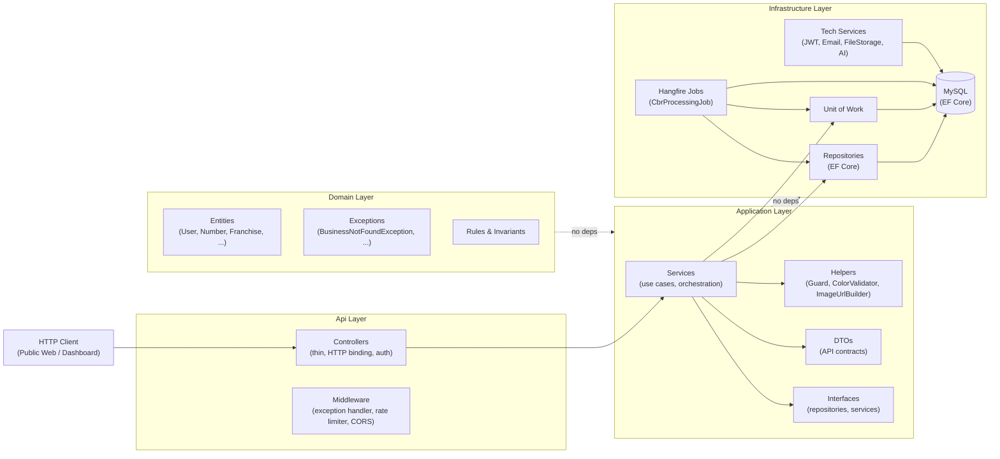

# Backend Architecture — Summary

## Architecture diagram

## Key decisions

### Architecture style
- **Modular Monolith** — not microservices, not event sourcing, not distributed CQRS
- **Clean Architecture** — Api → Application → Domain, Infrastructure → Application/Domain
- Domain-oriented boundaries with internal Application/Domain events

### Layers
- **Api**: thin controllers, HTTP binding, auth, DTOs, middleware
- **Application**: use cases, services, interfaces, DTOs, mappers, validation
- **Domain**: entities, value objects, rules, invariants, exceptions
- **Infrastructure**: EF Core, repositories, Unit of Work, persistence, file processing, external services

### Mandatory rules
1. Modular Monolith. No microservices without explicit decision.
2. Api / Application / Domain / Infrastructure separation.
3. Business rules in Domain or Application, never Infrastructure.
4. No direct exposure of persistence entities as API contracts.
5. Thin controllers.
6. Explicit repositories oriented to concrete entities.
7. No generic repository over `DbSet<T>`.
8. Explicit module boundaries.
9. No direct access to another module internals.
10. API contracts designed per use case.
11. Public and administrative capabilities separated by authorization.
12. Heavy media processing async (CBR import, image conversion).
13. No CBR processing inside HTTP request.
14. No direct database access from clients.
15. No client dependencies on persistence details.
16. No distributed complexity without demonstrated need.
17. Entities expose navigation properties only. No FK scalar properties.

### Explicitly discarded
- Microservices
- BFF
- Event Sourcing
- Distributed CQRS
- Independent databases per module
- Generic Repository Pattern
- Generic Service Layer
- CRUD-first Architecture

### Evolution
Must allow future incorporation of: user-created lists, community lists, collaborative crossovers/arcs, community reading orders, AI for users, semantic search, advanced recommendations, personal reading assistant, OCR, annotation analysis, advanced statistics. Extension must not break existing modules.

### Fundamental principle
Architecture optimizes evolution capacity, not pattern count. A pattern is introduced only when it solves a real problem. Complexity must be justified by business, scalability, maintainability, or isolation needs. Agents must not introduce patterns, layers, abstractions, or distributed components just because they are considered good practices in general.