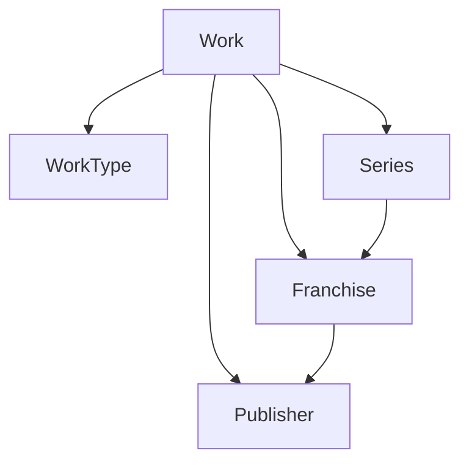

# Domain — Content

## Work

- **Location**: `Domain/Entities/Work.cs`
- **Fields**:
  - `long Id`
  - `string Title`
  - `string? Description`
  - `bool IsActive` (default `true`)
  - `DateTime? PublicationDate`
  - `DateTime CreatedAt`
  - `ContentStatus ContentStatus` (enum: `Missing=0`, `Processing=1`, `Completed=2`, `Error=3`)
  - `string? ContentError`
  - `bool IARequest` (default `false`)
  - `IAProcessingStatus? IAStatus` (enum: `Pending=0`, `Processing=1`, `Success=2`, `Error=3`)
  - `string? IAResult` (JSON-serialized `ComicAnalysisResult`)
  - `DateTimeOffset? IARequestedAt`
  - `virtual Language? Language`
  - `virtual Image? Cover`
  - `virtual File? File`
  - `virtual ICollection<PersonByRole> PersonByRoles`
  - `virtual ICollection<TagByWork> Tags`
  - `virtual ICollection<Page> Pages`
  - `virtual WorkType? WorkType`
  - `long WorkTypeId`
  - `virtual Series? Series`
  - `long? SeriesId`
  - `virtual Franchise? Franchise`
  - `long? FranchiseId`
  - `virtual Publisher? Publisher`
  - `long? PublisherId`
  - `string? NumberValue`
  - `virtual Work? PreviousNumber`
  - `long? PreviousNumberId`
  - `virtual Work? NextNumber`
  - `long? NextNumberId`
  - `int RatingCount` (default `0`)
  - `double AverageRating` (default `0`)
- **Notes**: Single entity representing all works in the catalog. Classified by `WorkType` (catalog entity). Hierarchy is determined by which FK is set:
  - `PublisherId != null` ? Publisher-direct work
  - `FranchiseId != null` ? Franchise-direct work (Publisher inferred via Franchise)
  - `SeriesId != null` ? Series work (Franchise/Publisher inferred via Series)
  Exactly one of `PublisherId`, `FranchiseId`, `SeriesId` should be set. `WorkType` is classification only, no structural rules depend on it.
  Helper methods: `GetSeriesId()`, `GetSeriesName()`, `GetFranchiseId()`, `GetFranchiseName()`, `GetPublisherId()`, `GetPublisherName()`, `GetPublisherCountryName()`, `GetPreviousNumberId()`, `GetPreviousNumberTitle()`, `GetPreviousNumberValue()`, `GetNextNumberId()`, `GetNextNumberTitle()`, `GetNextNumberValue()`, `GetFileId()`, `GetPagesCount()`, `GetLanguageId()`, `GetLanguageName()`, `GetCoverId()`, `GetWorkTypeName()`.
  **Rating accumulators**: `RatingCount` (total votes, zero-star votes included) and `AverageRating` (average of the received scores on a 0-5 scale, zero-star votes included) are stored on the Work to avoid recalculating them on every detail request. A Work without votes has `RatingCount = 0` and `AverageRating = 0`. `WorkRatingService` maintains them when a vote is created or edited; reading progress is never affected by a rating.
  **Indexes**: `IsActive`, `LanguageId`, `PublicationDate`, `ContentStatus`, `CoverId`, `FileId`, `SeriesId`, `FranchiseId`, `PublisherId`, `WorkTypeId`, `PreviousNumberId`, `NextNumberId`.

## WorkType

- **Location**: `Domain/Entities/WorkType.cs`
- **Fields**:
  - `long Id`
  - `string Name` (unique at DB level)
  - `bool IsActive` (default `true`)
  - `DateTime CreatedAt`
- **Notes**: Catalog entity for classifying works (e.g., "Number", "Graphic Novel", "Annual", "Special", "April Fool", "Swimmsuite Collection"). No structural rules depend on this value. **Indexes**: `Name` (unique), `IsActive`.

## Page

- **Location**: `Domain/Entities/Page.cs`
- **Fields**:
  - `long Id`
  - `int Order`
  - `virtual Work Work`
  - `virtual Image Image`
- **Notes**: Pages are extracted by `CbrProcessingJob` from the uploaded CBR/CBZ file. Each page is stored as an `Image` (with `Type = ImageType.Page`) and linked to the Work via `Page`. **Index**: `(WorkId, Order)` (unique) — supports the "list pages by work ordered by Order" query.

## Work hierarchy

Shared by all Works:
- Identity, Title, Description
- Language, PublicationDate, Cover, File
- ContentStatus, ContentErrorMessage
- Pages, Tags, PersonByRoles
- IsActive, CreatedAt
- WorkType (classification)
- Optional: SeriesId, FranchiseId, PublisherId (mutually exclusive)
- Optional: NumberValue, PreviousNumberId, NextNumberId (for numbered works)

Persistence uses a single `Works` table. `SeriesId`, `FranchiseId`, `PublisherId` are mutually exclusive nullable FKs. `NumberValue`, `PreviousNumberId`, `NextNumberId` are nullable. Relationships (`PersonByRole`, `TagByWork`, `Page`) reference `Work` via `WorkId` (FK with cascade delete).

## Audit note (2026-09)

The previous version of this document listed fields that the model does not have:

- `Number.Number` — wrong. The field is `NumberValue` (free-form string).
- `Person.IsFeatured` — does not exist.
- `Role.Type` — does not exist. Roles are a free-form taxonomy.
- `Image.OwnerEntityType` / `OwnerEntityId` — does not exist. The model uses a single `Files` table with a discriminator (`File` / `Image`) and a `Type` enum.
- `Country.IsFeatured` — does not exist.
- `BaseEntity` / `BaseEntityActivation` — do not exist. There is no common base class. Each entity declares its own `Id`, `CreatedAt`, and optionally `IsActive` directly.
- `BaseEntity.DeletedAt` — does not exist. Deactivation uses `IsActive` where applicable.

These corrections were validated by re-reading the entity files during the 2026-09 audit.

## WorkReadingProgress

- **Location**: `Domain/Entities/WorkReadingProgress.cs`
- **Fields**:
  - `long Id`
  - `int CurrentPage` (default `0`) — Reader position (1-based). `1` = page 1, `TotalPages + 1` = final form position.
  - `int TotalPages` (default `0`) — Total physical pages in the Work (from `Work.Pages.Count`).
  - `int PercentageReading` (default `0`) — Calculated: `(CurrentPage - 1) * 100 / TotalPages`. `0%` at page 1, `100%` at `TotalPages + 1`.
  - `DateTimeOffset? LastReadAt` — Timestamp of last progress update (UTC).
  - `ReadingState State` (default `Reading`) — Enum: `Reading` (0), `Completed` (1).
  - `virtual Work? Work` — Navigation to the Work.
  - `virtual User? User` — Navigation to the User.
- **Notes**: Single progress record per User + Work combination (unique index on `WorkId`, `UserId`). 
  - State transitions: `CurrentPage < TotalPages + 1` ? `Reading`; `CurrentPage >= TotalPages + 1` ? `Completed`.
  - Can transition back from `Completed` to `Reading` if user navigates to earlier page.
  - `LastReadAt` updated on every progress change.
  - `TotalPages` sourced from `Work.Pages.Count`, never from client.
  - **Index**: `(WorkId, UserId)` (unique).

## WorkRating

- **Location**: `Domain/Entities/WorkRating.cs`
- **Fields**:
  - `long Id`
  - `int Stars` (default `0`) — score on a 0-5 scale. Non-nullable: `0` is a valid vote meaning the user selected no star; it is not the absence of a vote.
  - `string? Review` — optional review text. It can be null even when the rating has a score, and a score can exist without a review. Every record is a vote for the Work, so a review always belongs to a vote.
  - `DateTime CreatedAt` — creation date in UTC.
  - `DateTime? UpdatedAt` — last modification date; null while the rating has never been edited.
  - `bool IsActive` (default `true`)
  - `virtual User User` — required navigation.
  - `virtual Work Work` — required navigation.
- **Notes**: Represents the vote/review of a user on a Work. **No scalar FK properties** (`UserId`, `WorkId`): EF Core manages them as shadow properties. One rating per User + Work (unique index on `WorkId`, `UserId`); `WorkRatingService` implements the create-or-edit rule on top of it. `CreatedAt` is never modified on edit; `UpdatedAt` is set on every edit. Creating or editing a rating never modifies `WorkReadingProgress`. **Index**: `(WorkId, UserId)` (unique).
- **Rating accumulators**: `Work.RatingCount` and `Work.AverageRating` include zero-star votes. On create, `RatingCount` increases by 1 and the average is recomputed with the new score. On edit, `RatingCount` never changes; the average is recomputed only when the score changes (comment-only edits leave the accumulators untouched).
## ListRating

- **Location**: Domain/Entities/ListRating.cs
- **Fields**:
  - long Id
  - int Stars — score of the list on a 1-5 scale. Required.
  - string? Review — optional review of the list.
  - DateTime CreatedAt — creation date in UTC.
  - DateTime? UpdatedAt — last modification date; null while the rating has never been edited.
  - ool IsActive (default 	rue)
  - irtual User User — required navigation.
  - irtual WorkList WorkList — required navigation.
- **Notes**: Rating of a user on a list. **No scalar FK properties** (UserId, WorkListId): EF Core manages them as shadow properties. One rating per User + WorkList (unique index on (WorkListId, UserId)), so a second save edits the existing row instead of creating a duplicate. CreatedAt is never modified on edit; UpdatedAt is set on every edit. WorkList.RatingCount and WorkList.AverageRating accumulate only active ratings. **Index**: (WorkListId, UserId) (unique).

## ListReadingProgress

- **Location**: Domain/Entities/ListReadingProgress.cs
- **Fields**:
  - long Id
  - irtual User User — required navigation.
  - irtual WorkList WorkList — required navigation.
  - irtual Work? CurrentWork — optional work of the list the user is currently reading; null when the user has not started the list or has finished it. It must belong to the list; the rules for updating it when the list composition changes belong to the service layer.
  - DateTimeOffset? LastReadAt — date of the last reading activity; null while the user has not read.
- **Notes**: Aggregate reading progress of a user on a list, created when the user starts reading the list. **No scalar FK properties** (UserId, WorkListId, CurrentWorkId): EF Core manages them as shadow properties. One record per User + WorkList (unique index on (WorkListId, UserId)). The percentage and the state of a list are **not persisted**: they are derived from the list composition and from the existing WorkReadingProgress records (completed works / total works, and Reading when at least one work of the list is in that state). **Index**: (WorkListId, UserId) (unique).